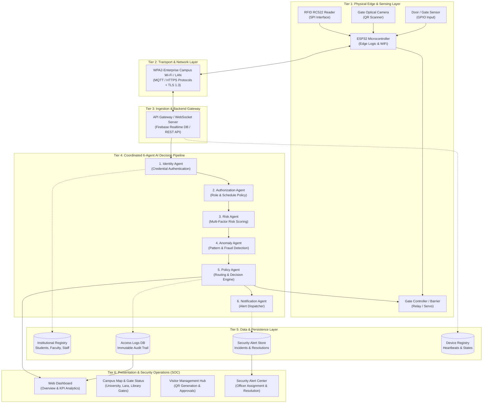
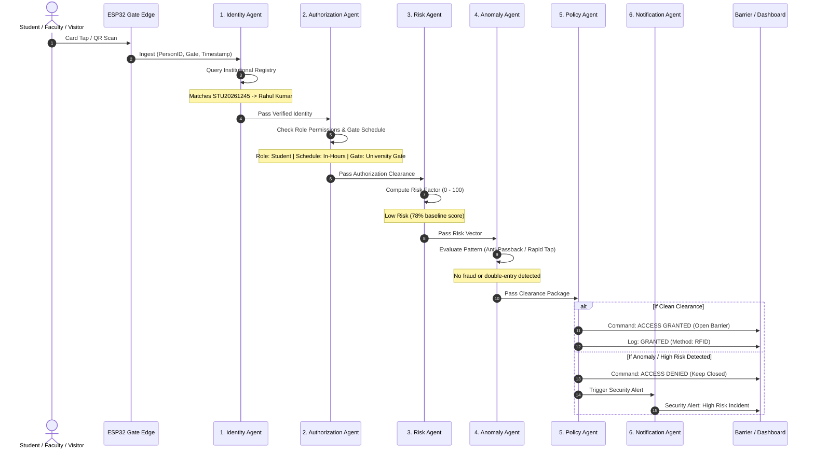
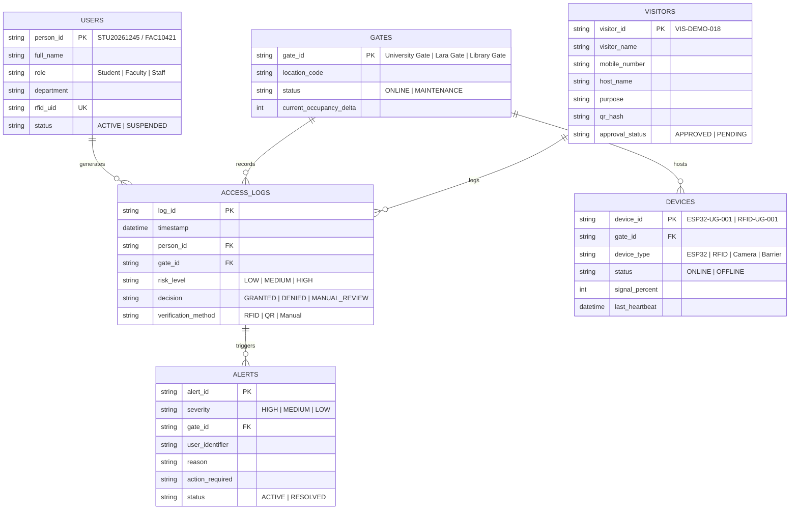
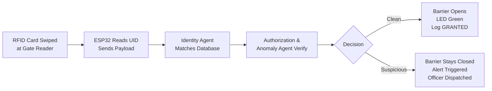
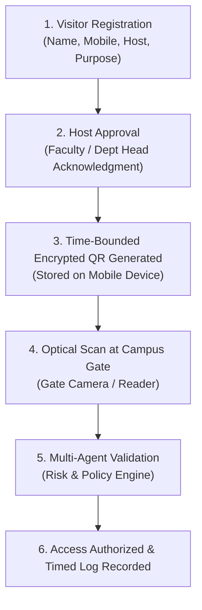

# System Architecture: Vignan Smart Access

## 1. Architectural Overview

**VIGNAN SMART ACCESS** is an agentic, distributed perimeter management system designed for **Vignan's Foundation for Science, Technology & Research (VFSTR)**. The system couples low-latency physical computing at perimeter gates with a multi-agent artificial intelligence decision pipeline hosted on cloud/backend infrastructure.

The architecture follows a **6-Tier Distributed Model**:
1. **Edge & Physical Sensing Layer**: Captures physical credentials (RFID smart cards, optical QR codes, device signals).
2. **Network & Transport Layer**: Delivers secure, low-latency telemetry over campus Wi-Fi infrastructure.
3. **Cloud & Backend Ingestion Layer**: Manages event queues, real-time synchronization, and state management.
4. **Agentic AI Decision Engine**: Coordinated six-agent pipeline evaluating identity, permissions, risk, anomalies, and policy enforcement.
5. **Data & Persistence Layer**: Tamper-evident audit logs, user registries, device states, and active incident databases.
6. **Operations Center (Presentation Layer)**: Web-based Command and Control Dashboard for campus security officers and administrators.

---

## 2. High-Level Multi-Tier System Diagram



---

## 3. Tier-by-Tier Architectural Specification

### 3.1 Tier 1: Edge & Hardware Architecture

Each campus entry point (**University Gate**, **Lara Gate**, **Library Gate**) is equipped with edge controllers managing local hardware peripherals.

- **Microcontroller**: **ESP32 Dual-Core Tensilica Xtensa 32-bit LX6** running at 240 MHz.
  - *Core 0*: Dedicated to network connectivity, TLS handshake, and MQTT/WebSocket message queuing.
  - *Core 1*: Dedicated to hardware pin polling, SPI communication with RFID, and local barrier relay actuation.
- **RFID Module**: **RC522 (13.56 MHz)** communicating via SPI.
  - Operating Distance: Up to 50 mm.
  - Protocols: ISO/IEC 14443 Type A, Mifare Classic 1K/4K.
- **Optical Scanner / Camera**: Reads dynamically generated 2D QR passes for visitors and event guests.
- **Actuator Subsystem**: 5V Relay module triggering high-torque motorized boom barriers or electronic magnetic strikes.
- **Offline Survivability (Local Cache)**: The ESP32 maintains an encrypted local cache (in SPIFFS / LittleFS) of essential faculty and emergency personnel IDs. If campus Wi-Fi drops, the gate defaults to fail-secure mode with white-listed fallback access.

#### Edge Circuitry & Pinout Layout:
```
+-------------------------------------------------------------------+
|                        ESP32 MICROCONTROLLER                      |
|                                                                   |
| [SPI BUS]                                                         |
|   GPIO 23 <----> MOSI (RC522)                                     |
|   GPIO 19 <----> MISO (RC522)                                     |
|   GPIO 18 <----> SCK  (RC522)                                     |
|   GPIO 5  <----> SDA/SS (RC522)                                   |
|   GPIO 22 <----> RST  (RC522)                                     |
|                                                                   |
| [ACTUATORS & SENSORS]                                             |
|   GPIO 26 <----> Relay Trigger (Barrier Open / Close)             |
|   GPIO 27 <----> Status LED (Green: Granted, Red: Denied)         |
|   GPIO 14 <----> Piezo Buzzer (Warning / Alarm)                    |
|   GPIO 34 <----> Optical Loop / Beam Break Sensor (Obstacle Det.) |
+-------------------------------------------------------------------+
```

---

### 3.2 Tier 2: Network & Communication Protocol

Data exchange across campus gates is designed for low latency (< 150 ms end-to-end response time):
- **Transport Security**: TLS 1.3 encryption across all Wi-Fi and WAN communications.
- **Telemetry Messaging**: Lightweight JSON payloads transmitted over **MQTT** (Message Queuing Telemetry Transport) with Quality of Service (QoS 1) or persistent **Secure WebSockets**.
- **Heartbeat & Telemetry**: Edge devices publish a heartbeat payload every 5 seconds containing:
  ```json
  {
    "device_id": "ESP32-UG-001",
    "gate": "University Gate",
    "status": "ONLINE",
    "signal_dbm": -58,
    "uptime_seconds": 84210,
    "barrier_state": "CLOSED",
    "timestamp": "2026-10-12T08:41:20Z"
  }
  ```

---

### 3.3 Tier 3: Ingestion & Backend Gateway

The ingestion layer normalizes events from heterogeneous gate sensors:
- **Event De-duplication**: Filters accidental double-taps occurring within 1.5 seconds.
- **Session Dispatcher**: Packages incoming entry requests with real-time metadata (Gate ID, Timestamp, Reader Method) and hands them off to the Multi-Agent Pipeline.

---

### 3.4 Tier 4: The Coordinated Six-Agent AI Engine

Access decisions are not handled by monolithic if-else rules. Instead, six specialized autonomous agents collaborate in a sequential evaluation chain:



#### Detailed Agent Specifications:

| Agent | Core Responsibilities | Input Data | Output / Signal |
| :--- | :--- | :--- | :--- |
| **1. Identity Agent** | Verifies card UID / person ID against the central university database. | `person_id`, `rfid_uid`, `credential_type` | `Identity_Status: {VERIFIED, UNKNOWN, EXPIRED}` |
| **2. Authorization Agent** | Evaluates role permissions (e.g. Day Scholar vs. Hosteler curfew hours, staff clearance, library membership). | User Role, Current Timestamp, Gate ID | `Auth_Status: {AUTHORIZED, RESTRICTED, TIME_LOCKED}` |
| **3. Risk Agent** | Aggregates contextual signals to produce a risk score (**Low, Medium, High**). | User history, previous incident flags, pass type | `Risk_Score: {LOW, MEDIUM, HIGH}` |
| **4. Anomaly Agent** | Detects fraudulent behaviors: Anti-passback violations, card sharing, impossible geographic transit times. | Historical log window (last 60 min), Gate coordinates | `Anomaly_Flag: {NONE, RAPID_REENTRY, TAILGATING, SPOOF}` |
| **5. Policy Agent** | Synthesizes all agent outputs and issues an actionable command. | Aggregated Outputs (Agents 1-4) | `Decision: {GRANTED (Fast Lane), DENIED, MANUAL_REVIEW}` |
| **6. Notification Agent** | Dispatches real-time alerts to the Operations Dashboard and on-duty security officers. | Severity, Gate ID, User Detail, Reason | `Alert_Dispatched: {ACTIVE, Assigned Officer}` |

---

### 3.5 Tier 5: Data & Persistence Model

The storage layer isolates sensitive student records from high-throughput access logs.

#### Core Entity Relational Diagram:


---

### 3.6 Tier 6: Command Center & Security Operations (SOC)

The presentation interface provides unified operational command:
1. **Executive Dashboard**: Displays global health indicators:
   - *Total Authorized Entries*
   - *Live People Inside Estimate* (Calculated by cumulative `Entries - Exits`)
   - *Pending Verifications Queue*
   - *Active High-Risk Alerts Count*
2. **Interactive Campus Spatial Map**: Stylized interactive view featuring the campus topology, road arteries, and live gate status indicators for:
   - `University Gate`
   - `Lara Gate`
   - `Library Gate`
3. **Visitor Management Engine**: End-to-end QR code pass issuance, host mapping, and purpose logging.
4. **IoT Device Monitor**: Telemetry dashboard providing visual indicators of device connectivity, Wi-Fi link quality, and heartbeat counters with simulated failure injection.
5. **Security Alert Center**: Actionable incident handling workflow enabling security officers to review, assign, and resolve gate alerts in real time.

---

## 4. End-to-End Operational Workflows

### 4.1 Student / Faculty Fast-Lane Access Flow


### 4.2 Visitor Registration & Dynamic QR Lifecycle


---

## 5. Security, Resilience, and Compliance

1. **Anti-Passback (APB) Enforcement**:
   - The Anomaly Agent tracks the current occupancy state of each credential. If a card marked as "Inside" is scanned again at an entry reader without a matching exit record, a `HIGH RISK - SUSPECTED PASSBACK` alert is generated immediately.
2. **Tamper Prevention & Rate Limiting**:
   - Rapid multi-tap attempts (> 3 failed attempts in 30 seconds) trigger a local buzzer lockout on the ESP32 and freeze the gate in a closed state while alerting the operations desk.
3. **Auditability & Regulatory Compliance**:
   - All gate events are logged with microsecond timestamps, credential identifiers, and agent reasoning.
   - Access records support one-click CSV export for institutional safety audits and statutory reporting.
4. **Data Privacy**:
   - Mobile numbers and personal identifiable information (PII) of visitors and students are masked on frontline guard displays to prevent unauthorized data exposure.
