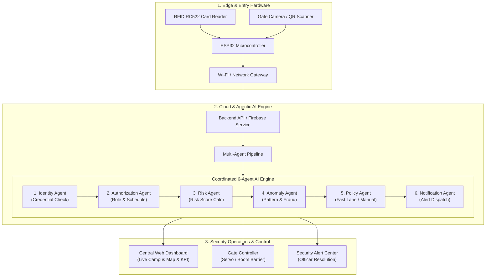

# Problem Statement: Vignan Smart Access

## 1. Context and Background

**Vignan's Foundation for Science, Technology & Research (VFSTR - Deemed to be University)**, located in Vadlamudi, Guntur, Andhra Pradesh, is a large-scale academic institution catering to thousands of students, faculty members, administrative staff, day scholars, hostel residents, and daily campus visitors (such as parents, vendors, and guests).

The university operates across a multi-gate campus layout with three critical entry and exit points:
1. **University Gate (Main Entrance)**: Handles heavy vehicular traffic, university buses, day scholars, and main campus visitors.
2. **Lara Gate**: Serves the adjacent Lara campus sector, staff, and localized student transit.
3. **Library Gate (NTR Vignan Library Access)**: Controls access into critical academic and study infrastructure.

Ensuring secure, frictionless, and transparent perimeter access across these gates is vital for institutional safety, disciplined campus operations, and asset protection.

---

## 2. Problem Statement

Traditional university gate security systems rely heavily on manual guard observation, physical register books, and standalone, un-synchronized access barriers. These legacy mechanisms fail to meet modern campus security demands, leading to serious operational challenges:

```
+--------------------------------------------------------------------------------------------------+
|                                    LEGACY ACCESS LIMITATIONS                                     |
+--------------------------------------------------------------------------------------------------+
|  1. Peak-Hour Congestion: Manual checking creates severe delays at university entry gates.        |
|  2. Unverified Visitors: Paper logs permit unverified identities and untracked campus movement.   |
|  3. Decentralized Gates: No real-time awareness of total campus occupancy or inter-gate transits. |
|  4. Credential Misuse: Inability to detect card swapping, rapid multi-entries, or tailgating.    |
|  5. Silent Hardware Failures: No live telemetry for RFID readers, cameras, or barrier controls.   |
+--------------------------------------------------------------------------------------------------+
```

### Key Challenges Identified:

1. **Peak-Hour Congestion & Human Error**:
   - During morning arrival and evening departure hours, security guards cannot manually verify student ID cards, faculty credentials, and visitor passes without causing vehicular queues and pedestrian congestion.
   - Guards cannot cross-reference student suspension lists, hostel curfew permissions, or invalid IDs in real time.

2. **Insecure and Unverified Visitor Management**:
   - Visitors (parents, vendors, delivery personnel, external guests) write manual entries in physical logbooks.
   - These records lack host pre-approval, timestamped checkouts, digital identity verification, and auditability.
   - Security has no visibility into whether a visitor actually visited their claimed host or remained on campus past permitted hours.

3. **Absence of Unified Real-Time Campus Visibility**:
   - Individual gates function as disconnected silos.
   - Administrators cannot answer fundamental security questions: *How many people are currently inside the campus?*, *Has an individual entered through University Gate and exited via Lara Gate?*, or *Which sector has unusual crowd density?*

4. **Inability to Detect Anomalous & Coordinated Threats**:
   - Traditional RFID card readers act as binary switches ("valid card ID = open gate").
   - They cannot assess context: *Did this student ID just scan at another gate 3 minutes ago?*, *Is an unauthorized credential attempting repeated rapid scans?*, or *Does this user's profile match the gate policy?*

5. **Lack of IoT Telemetry & Hardware Health Auditing**:
   - Field devices (RFID readers, ESP32 microcontrollers, IP cameras, motorized boom barriers) experience network dropouts or hardware faults without alerting operators, leaving perimeter gates unmonitored.

---

## 3. Proposed Solution: VIGNAN SMART ACCESS

**VIGNAN SMART ACCESS** addresses these challenges by replacing manual and fragmented gate checks with an **Agentic AI-driven, IoT-integrated access management ecosystem**.

The platform combines edge sensing, cloud connectivity, multi-agent AI verification, and a central security operations dashboard.



---

## 4. System Architecture & Core Capabilities

### 4.1 The Six-Agent Coordinated AI Pipeline
Rather than relying on a single static rule, access decisions are evaluated by a specialized multi-agent workflow:
- **Identity Agent**: Validates person ID against the central university institutional registry (Students, Faculty, Staff, Visitors).
- **Authorization Agent**: Verifies role permissions, active schedules, hostel passes, and gate-specific entry authorizations.
- **Risk Agent**: Computes dynamic risk levels (**Low: 78%**, **Medium: 18%**, **High: 4%**) based on history and entry factors.
- **Anomaly Agent**: Flags suspicious activity, such as rapid duplicate card scans, impossible velocity between distant gates, or invalid ID patterns.
- **Policy Agent**: Determines actionable routing—granting immediate **Fast Lane** entry, requiring **Standard Inspection**, or ordering **Manual Security Review**.
- **Notification Agent**: Instantly dispatches alerts to security personnel when suspicious attempts or physical device disconnections occur.

### 4.2 Digital QR-Based Visitor Management Workflow
Replaces paper visitor logs with an end-to-end digital lifecycle:
1. **Visitor Registration**: Pre-registration or on-spot intake with visitor name, phone number, host details, and purpose.
2. **Host Approval**: Digital acknowledgment from the corresponding faculty or department head.
3. **Encrypted QR Pass**: Single-use digital QR pass issued to the visitor's mobile device.
4. **Gate Scanning**: Gate camera or optical scanner verifies QR code at the selected gate.
5. **AI Validation & Log**: Risk assessment executed and logged with entry and exit timestamps.

### 4.3 IoT & Edge Hardware Integration Roadmap
- **RFID RC522 Reader**: High-frequency RFID contactless credential scanning for students and faculty cards.
- **ESP32 Edge Microcontroller**: Real-time sensor processing, Wi-Fi connectivity, and low-latency motor/barrier control.
- **Cloud Database (Firebase / REST)**: Synchronizes real-time device heartbeats, event logs, and gate states.
- **Hardware Telemetry**: Proactive monitoring of device status (`ONLINE` / `OFFLINE`), signal strength, and heartbeat intervals.

### 4.4 Central Security Operations Dashboard
- **Live Campus KPIs**: Total Authorized Entries, Live People Inside estimate, Pending Verifications, and Active High-Risk Alerts.
- **Multi-Gate Monitoring**: Centralized status for University Gate, Lara Gate, and Library Gate.
- **Stylized Campus Map**: Visual spatial overview with gate markers and campus building overlays.
- **Audit Logs & Export**: Real-time event log with multi-criteria filtering (Gate, User Type, Risk Level, Decision) and CSV export for compliance reporting.
- **Alert Resolution Center**: Security officer assignment and resolution tracking for flagged threats.

---

## 5. Stakeholders & User Roles

| Stakeholder | Key Interactions & Benefits |
| :--- | :--- |
| **Students & Faculty** | Fast, touchless entry using standard campus RFID smart cards; minimized waiting queues. |
| **Campus Visitors & Parents** | Transparent pre-registration, digital QR access pass, and reduced friction at the security gate. |
| **Gate Security Guards** | Instant visual decisions (Granted vs. Manual Review), automated alert prompts, and streamlined visitor intake. |
| **Chief Security Officer (CSO)** | Centralized visibility over all 3 entry gates, live campus headcount, device health, and incident response workflow. |
| **University Administration** | Reliable audit trails, compliance logs, reduced unauthorized entries, and data-backed security analytics. |

---

## 6. Project Scope & Roadmap

### Current Scope (Presentation Prototype):
- High-fidelity interactive Operations Dashboard adhering to Vignan University branding.
- Visual status and reference imagery for all 3 campus gates.
- Interactive multi-agent verification simulation with low/high risk credential scenarios.
- Visitor pass generator with dynamic QR preview.
- IoT device state management with simulated hardware disconnections and event generation.
- Full access log search, filtering, and CSV download capabilities.

### Future Implementation Roadmap:
- Deployment of physical ESP32 and RC522 modules onto automated physical boom barriers.
- Hardware-level connection to institutional ERP/database for live student and employee validation.
- Integration of Automated Number Plate Recognition (ANPR) cameras for university transport and visitor vehicles.
- Push notification integration (SMS / WhatsApp / Institutional App) for immediate security alerts.
