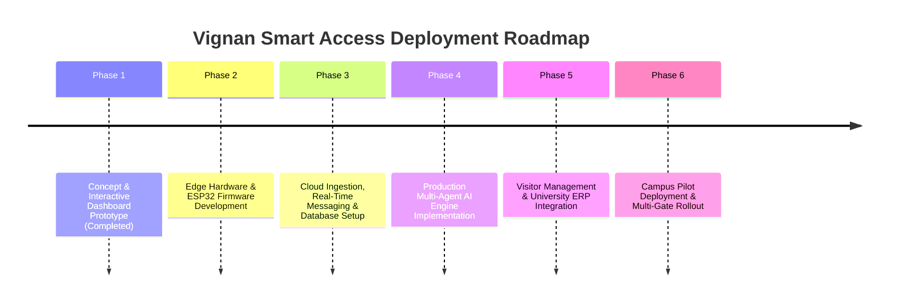
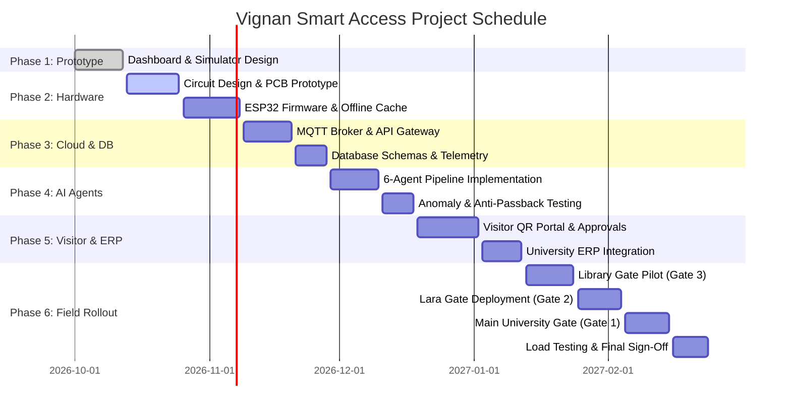

# Phase-Wise Implementation Plan: Vignan Smart Access

## 1. Executive Summary & Phasing Strategy

This document outlines the end-to-end, phase-wise implementation roadmap for deploying **VIGNAN SMART ACCESS** across the campus perimeter of **Vignan's Foundation for Science, Technology & Research (VFSTR)** in Vadlamudi.

The roadmap transitions the project from its current **high-fidelity interactive prototype** into a fully operational, production-grade edge-to-cloud security platform integrated with physical gate infrastructure and the central institutional database.

---

## 2. Phase Breakdown Matrix

| Phase | Title | Focus Area | Primary Deliverables | Target Horizon |
| :---: | :--- | :--- | :--- | :---: |
| **Phase 1** | **Interactive Prototype & SOC Simulation** | Frontend & System Logic | Operations dashboard, gate map, 6-agent simulation, log export | **Completed** |
| **Phase 2** | **Edge Hardware & Firmware Integration** | Microcontroller & Sensors | ESP32 circuit, RC522 SPI driver, relay barrier control, LittleFS cache | Weeks 1 – 4 |
| **Phase 3** | **Cloud Ingestion & Real-Time Sync** | Backend & Communications | MQTT broker / Firebase, WebSocket server, API gateway, telemetry | Weeks 5 – 7 |
| **Phase 4** | **Agentic AI Engine Productionization** | Intelligence & Security | 6 autonomous micro-agents, anomaly algorithms, APB logic | Weeks 8 – 10 |
| **Phase 5** | **Visitor Portal & ERP Integration** | Enterprise Interop | Dynamic QR pass issuance, host approval portal, ERP connector | Weeks 11 – 13 |
| **Phase 6** | **Campus Field Deployment & Pilot Test** | Physical Rollout | Physical gate installations, peak-load drills, security sign-off | Weeks 14 – 16 |

---

## 3. Detailed Phase Specifications

### Phase 1: Prototype Validation & SOC Simulation *(Completed)*
* **Objective:** Establish the visual identity, interaction models, and proof-of-concept pipeline for Vignan University gate operations.
* **Key Tasks:**
  - Designed the unified Command Center UI adhering to Vignan colors (Blue `#1479c9`, Purple `#8274c6`, Red `#df2633`, Light background `#f4f7fb`).
  - Configured status views and reference imagery for all 3 campus gates: **University Gate**, **Lara Gate**, and **Library Gate**.
  - Implemented the 6-agent sequential pipeline simulator (`Identity` $\rightarrow$ `Authorization` $\rightarrow$ `Risk` $\rightarrow$ `Anomaly` $\rightarrow$ `Policy` $\rightarrow$ `Notification`).
  - Built visitor management intake with dynamic QR code preview generation.
  - Implemented simulated IoT heartbeat toggles, live access logs, multi-attribute filtering, and CSV export.
* **Sign-Off Criteria:** Prototype executes end-to-end access scenarios without runtime errors in modern web browsers.

---

### Phase 2: Edge Hardware & Microcontroller Firmware
* **Objective:** Construct and benchmark edge controller prototypes using ESP32 and RC522 modules for physical perimeter hardware.
* **Work Breakdown Structure (WBS):**
  1. **Circuit Assembly & Bench Prototyping:**
     - Breadboard and PCB design connecting ESP32 to RC522 RFID reader over SPI (`MOSI: 23`, `MISO: 19`, `SCK: 18`, `SS: 5`, `RST: 22`).
     - Wire 5V relay module (`GPIO 26`) to simulate barrier gate trigger; attach dual-color status LEDs (`GPIO 27`) and alert buzzer (`GPIO 14`).
     - Integrate optical beam-break sensor (`GPIO 34`) for anti-tailgating vehicle/pedestrian detection.
  2. **Firmware Development (C++ / ESP-IDF / Arduino Core):**
     - Multithreading implementation: FreeRTOS Task 0 (Network, MQTT, TLS handshake) and Task 1 (Interrupt-driven RFID polling and relay pulsing).
     - Local offline cache using ESP32 `LittleFS`: Stores up to 2,000 emergency whitelist credentials for uninterrupted fail-secure operation during Wi-Fi outages.
     - Hardware Watchdog Timer (WDT) to automatically restart the microcontroller in case of heap freeze or network hang.
* **Success Metrics:**
  - Card detection latency under **40 ms**.
  - Seamless fallback to offline cache within **100 ms** of network disconnect.

---

### Phase 3: Cloud Ingestion, Messaging & Persistence
* **Objective:** Build the cloud gateway and pub/sub architecture connecting perimeter gates to the cloud backend.
* **Work Breakdown Structure (WBS):**
  1. **Real-Time Telemetry Pipeline:**
     - Deploy a high-throughput **MQTT Broker** (Eclipse Mosquitto / EMQX) or **Firebase Realtime Database** with TLS 1.3 encryption.
     - Define standardized gate topics:
       - `vignan/gates/{gate_id}/telemetry` (Heartbeats, signal dBm, uptime).
       - `vignan/gates/{gate_id}/request` (Credential tap payload).
       - `vignan/gates/{gate_id}/command` (Barrier open/hold signals).
  2. **Backend API Gateway & Database Schema:**
     - Implement REST / WebSocket server (FastAPI or Node.js) interfacing with PostgreSQL / Firebase.
     - Instantiate schemas defined in Architecture: `Users`, `Gates`, `Devices`, `Visitors`, `AccessLogs`, and `Alerts`.
     - Implement rate-limiting and anti-rebound buffering (reject duplicate taps within 1.5s).
* **Success Metrics:**
  - Roundtrip latency from card tap at gate to backend receipt under **80 ms**.
  - Scalability validated for 50 concurrent transactions per second.

---

### Phase 4: Production Multi-Agent AI Engine Deployment
* **Objective:** Implement the autonomous 6-agent decision pipeline with real-time heuristic algorithms and fraud detection models.
* **Work Breakdown Structure (WBS):**
  1. **Agent 1 (Identity Agent):** Connects to institutional database; validates UID format, card expiry, and suspension flags.
  2. **Agent 2 (Authorization Agent):** Role-based access control (RBAC). Evaluates time-of-day policies (Day Scholar access windows, Hostel curfew hours, Faculty 24/7 access).
  3. **Agent 3 (Risk Agent):** Multi-factor scoring model. Analyzes user historical violations, gate risk weighting, and off-hour entry factors.
  4. **Agent 4 (Anomaly Agent):**
     - **Anti-Passback (APB) Algorithm**: Flags cards attempting consecutive entries without recorded exit.
     - **Velocity Check**: Detects impossible travel speeds (e.g. card tapped at University Gate and 45 seconds later at Library Gate).
  5. **Agent 5 (Policy Agent):** Decision arbitrator outputting `FAST_LANE_GRANT`, `STANDARD_INSPECT`, or `MANUAL_REVIEW_DENY`.
  6. **Agent 6 (Notification Agent):** Instant alert distribution over WebSockets to Dashboard and SMS/Push to security officers.
* **Success Metrics:**
  - Total agent pipeline decision time under **120 ms**.
  - Zero false positives on valid faculty/student credentials during benchmark tests.

---

### Phase 5: Visitor Management Portal & Institutional ERP Sync
* **Objective:** Deliver the end-to-end visitor pass workflow and synchronize data with Vignan University's student and employee registries.
* **Work Breakdown Structure (WBS):**
  1. **Digital Visitor Pass Engine:**
     - Web intake portal for campus visitors to pre-register.
     - Automated host notification (Email/SMS) allowing faculty/department heads to click "Approve" or "Reject".
     - Generation of cryptographically signed, time-expiring QR passes.
  2. **ERP & SIS Integration:**
     - Secure API connector syncing daily student enrollments, status changes, and faculty RFID assignments from Vignan's central database.
     - Role synchronization ensuring revoked student privileges or alumni cards are instantly updated in the gate blacklist.
* **Success Metrics:**
  - Visitor pass verification via gate camera under **1 second**.
  - Automated daily ERP delta synchronization completed in under 2 minutes.

---

### Phase 6: Field Deployment, Campus Pilot & Rollout
* **Objective:** Install physical hardware at campus entry points, execute stress drills, and transition into daily operations.
* **Deployment Sequence:**
  1. **Pilot Site Installation (Library Gate):**
     - Install turnstile / gate controller enclosure, optical QR scanner, ESP32 hub, and status displays.
     - Run a 2-week internal pilot with library student entries.
  2. **Secondary Gate Installation (Lara Gate):**
     - Deploy vehicular barrier and pedestrian reader modules at Lara Gate.
     - Validate inter-gate sync between Library and Lara gates.
  3. **Main Perimeter Installation (University Gate):**
     - Install multi-lane vehicular boom barriers and high-capacity RFID scanners at Main University Gate.
  4. **Stress Testing & Drills:**
     - Morning peak-hour rush simulation (8:30 AM – 9:15 AM).
     - Security incident drills (unauthorized entry, blacklisted card, Wi-Fi outage failover).
     - Fire alarm integration: Connect central fire alarm panel to GPIO interrupt for automatic fail-open barrier release during emergencies.
* **Success Metrics:**
  - Gate clearance capacity exceeding **30 persons/minute per lane**.
  - 99.9% gate uptime over 30 consecutive operating days.

---

## 4. Master Gantt Schedule

---

## 5. Risk Assessment & Mitigation Plan

| Risk Event | Severity | Probability | Impact | Mitigation Strategy |
| :--- | :---: | :---: | :--- | :--- |
| **Campus Wi-Fi Outage** | High | Medium | Perimeter gates unable to reach cloud AI engine. | ESP32 `LittleFS` local offline cache holds active student/staff whitelist; logs transactions locally and auto-syncs upon reconnect. |
| **Morning Rush Congestion** | High | High | Long queues form at University Gate during morning arrival. | Edge pre-filtering allows standard RFID tags to open barriers in < 150 ms; multi-agent analysis runs asynchronously. |
| **Card Sharing / Passback Fraud** | Medium | High | Students pass ID cards through fence/barrier to peers. | Anti-Passback (APB) flags duplicate entries without recorded exit; optical beam sensors detect tailgating. |
| **Physical Tampering or Disconnect** | High | Low | Vandalism or sensor line cut at perimeter post. | Enclosed IP65-rated tamper-resistant enclosures; immediate notification generated when heartbeat drops for > 15 seconds. |
| **Emergency Fire / Disaster Event** | Critical | Low | Barriers lock individuals inside campus during evacuation. | Hardwired fire alarm interlock cuts relay power, causing barriers to automatically drop/open into fail-safe mode. |

---

## 6. Success & Completion Criteria

The deployment will be deemed complete upon meeting the following quantitative milestones:
1. **Response Latency:** Card tap to barrier opening under **200 ms** under full network load.
2. **Reliability:** Greater than **99.9%** availability across all 3 entry gates over a 30-day testing window.
3. **Visitor Accountability:** 100% digital trace for external campus visitors replacing paper registers.
4. **Data Integrity:** Fully exportable, tamper-evident audit logs matching physical entries with zero unlogged transactions.
